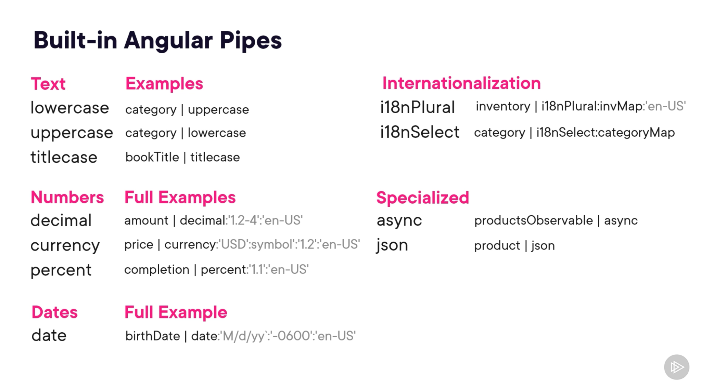

# Angular Components & Templates — Pipes

## Topics Covered

1. **Exploring the Built-in Angular Pipes**
2. **Using Built-in Pipes**
3. **Creating Custom Pipes**
4. **Pure Versus Impure Pipes**

---

# 1. Exploring the Built-in Angular Pipes

## Simple Concept

A pipe lets us **transform a value for display in the template**.

The original data does not need to change.

```text
original value
      ↓
pipe
      ↓
formatted value shown in the UI
```

Example:

```text
4.99
→ currency pipe
→ $4.99
```

The important idea is:

```text
Component keeps the real value
Template uses a pipe to decide how that value should look
```

---

## Why / When Do We Use Pipes?

Use a pipe when the value is already correct, but the UI needs a different presentation.

Examples:

```text
"beans"
→ uppercase
→ "BEANS"

4.99
→ currency
→ "$4.99"

0.25
→ percent
→ "25%"

Date value
→ date
→ formatted date
```

So pipes help keep **display transformation** out of normal component logic.

---

## Syntax

```html
{{ value | pipeName }}
```

Read it as:

```text
value
→ value we already have

|
→ send it through a pipe

pipeName
→ transformation to apply
```

---

## Pipe Parameters

Some pipes accept extra settings.

```html
{{ value | pipeName:param1:param2 }}
```

Example:

```html
{{ price | currency:'USD':'symbol' }}
```

The colon `:` separates parameters.

---

## Built-in Pipe Categories

Angular provides built-in pipes for common formatting needs.

### Text

```text
lowercase
uppercase
titlecase
```

### Numbers

```text
decimal
currency
percent
```

### Dates

```text
date
```

### Internationalization

```text
i18nPlural
i18nSelect
```

### Specialized

```text
async
json
```

The course uses **i18n** as the abbreviation for internationalization.

---

## Built-in Pipes Reference



You do not need to memorize every parameter now.

The important question is:

```text
Do I need a common display transformation?
→ Check whether Angular already provides a built-in pipe
```

---

## Important Rule

A pipe changes the **displayed result**.

It does not mean:

```text
permanently change the original value
```

---

## Memory Rule

```text
Pipe
→ transform a value for display

Syntax
→ value | pipeName

Parameters
→ value | pipeName:param
```

---

# 2. Using Built-in Pipes

## Simple Concept

If Angular already provides the transformation you need, use the built-in pipe instead of writing the formatting yourself.

Your `ProductDetailsComponent` already uses this idea for price formatting.

```text
price
      ↓
currency pipe
      ↓
formatted currency in UI
```

---

## Why / When Do We Use Built-in Pipes?

Use them for common display problems:

```text
price
→ currency

percentage
→ percent

date
→ date

inventory count
→ i18nPlural
```

---

## Your Currency Example

You calculate the discounted price in the template:

```html
@let discountedPrice =
  p.price * (1 - p.discount) | currency:'INR';
```

Conceptually:

```text
price after discount
      ↓
currency pipe
      ↓
format as INR
      ↓
store formatted result in discountedPrice
```

The pipe is responsible for the **display format**.

---

## Built-in Pipes and CommonModule

Your `ProductDetailsComponent` imports:

```ts
imports: [CommonModule, CategoryToPipeTypePipe]
```

Why?

Because built-in Angular pipes used by this component come from Angular common features.

Conceptually:

```text
ProductDetailsComponent wants built-in pipes
      ↓
import CommonModule
      ↓
template can use those pipes
```

---

# Using `i18nPlural` in Your Inventory UI

## Simple Concept

Yesterday you used:

```text
@if
@else if
@else
```

to show different inventory messages.

That works.

But this requirement can also be viewed as:

```text
inventory number
→ matching text
```

That is what `i18nPlural` can handle.

---

## Why / When?

Use `i18nPlural` when a number determines what text should be displayed.

Your inventory rules are:

```text
0
→ Out of Stock

1
→ Only one left

2–4
→ Few left

everything else
→ Get yours today
```

Instead of several template conditions:

```text
inventory number
      ↓
i18nPlural
      ↓
inventoryMap
      ↓
correct message
```

---

## Your `inventoryMap`

```ts
inventoryMap = {
  '=0': 'Out of Stock!!!',
  '=1': 'Only one left!',
  '=2': 'Few left!',
  '=3': 'Few left!',
  '=4': 'Few left!',
  'other': 'Get your today !'
};
```

This object contains the display rules.

---

## Syntax

```html
{{ availableInventory() | i18nPlural:inventoryMap }}
```

Read it as:

```text
availableInventory()
→ current inventory number

i18nPlural
→ choose text based on that number

inventoryMap
→ rules the pipe should use
```

This follows the standard pipe pattern:

```text
value | pipe:parameter
```

---

## Important Rule

The reason this is cleaner than the earlier `@if / @else if` chain is that the problem is specifically:

```text
number
→ text
```

So the pipe encapsulates that display transformation.

---

## Memory Rule

```text
Built-in pipe
→ Angular already provides the transformation

CommonModule
→ makes built-in pipes available

i18nPlural
→ number + map → display text
```

---

# 3. Creating Custom Pipes

## Simple Concept

Built-in pipes solve common display problems.

But sometimes your application has its own transformation.

Example from your grocery store:

```text
"grains"
→ should display as
→ "Grain"
```

Angular does not have a built-in pipe for this exact rule.

So you create a **custom pipe**.

---

## Why / When Do We Create a Custom Pipe?

Create one when:

```text
the transformation is specific to your application
AND
you want to reuse it cleanly in templates
```

Before the custom pipe, category display used a `@switch`.

The goal now is:

```text
template
→ asks for transformed value

custom pipe
→ owns transformation logic
```

This keeps the template smaller.

---

## Creating the Pipe

The course uses Angular CLI:

```bash
ng g pipe categoryToPartType
```

Conceptually:

```text
Angular CLI
      ↓
creates pipe class
      ↓
pipe defines transform()
      ↓
component imports pipe
      ↓
template uses pipe name
```

---

## What Makes a Class a Pipe?

A custom pipe has three important pieces:

```text
@Pipe
→ tells Angular this class is a pipe

name
→ name used in the template

transform()
→ receives a value and returns the transformed value
```

Your custom pipe:

```ts
@Pipe({
  name: 'categoryToPipeType',
})
export class CategoryToPipeTypePipe implements PipeTransform {
  transform(category: string, uppercase: boolean): string {
    ...
  }
}
```

The important concept is:

```text
template value
      ↓
transform()
      ↓
new display value
```

---

## How Template Syntax Maps to `transform()`

Your template:

```html
{{ p.category | categoryToPipeType:false }}
```

Your method:

```ts
transform(category: string, uppercase: boolean): string
```

The mapping is:

```text
p.category
→ category parameter

:false
→ uppercase parameter
```

So:

```text
value before |
→ first transform() parameter

values after :
→ additional transform() parameters
```

---

## Your Example

Suppose:

```text
p.category = "grains"
```

If the template uses:

```html
{{ p.category | categoryToPipeType:true }}
```

the flow is:

```text
"grains"
      ↓
categoryToPipeType
      ↓
transform("grains", true)
      ↓
uppercase first letter
+
remove final "s"
      ↓
"Grain"
```

If the second argument is `false`, the pipe does not uppercase the first letter.

---

## Why This Is Better Than the Earlier `@switch`

Before:

```text
ProductDetailsComponent template
→ contains all category transformation rules
```

After:

```text
ProductDetailsComponent template
→ asks for transformed category

CategoryToPipeTypePipe
→ owns transformation
```

The template becomes easier to read.

---

## Important Rule

A custom pipe should represent a **reusable value transformation**.

Think:

```text
input value
→ transformation
→ output value
```

---

## Memory Rule

```text
Custom pipe
→ application-specific transformation

@Pipe
→ marks the class as a pipe

name
→ used in template

transform()
→ receives input and returns output
```

```text
value | customPipe:param
      ↓
transform(value, param)
```

---

# 4. Pure Versus Impure Pipes

## Simple Concept

This topic is about:

```text
When should Angular run the pipe again?
```

Pipes are **pure by default**.

For arrays and objects, a pure pipe mainly reacts when the **reference changes**.

It does not deeply watch every mutation inside the same array or object.

---

## Why / When Does This Matter?

Your `CatalogComponent` uses a custom pipe to filter products.

```text
products
      +
categoryFilter
      ↓
categoryTofilterPipe
      ↓
filtered products
      ↓
@for renders them
```

Your template:

```html
@for (
  prod of products | categoryTofilterPipe:categoryFilter;
  track prod.id
) {
  ...
}
```

Your pipe:

```ts
transform(products: IProduct[], category: string | null): IProduct[] {
  if (!category) {
    return products;
  }

  return products.filter(p => p.category == category);
}
```

So:

```text
no category
→ return all products

category selected
→ return only matching products
```

---

# The Important Problem: Mutation

Suppose you modify the existing array like this:

```ts
products.push(newProduct);
```

Conceptually:

```text
before
→ Array A

after push()
→ still Array A
→ contents changed
→ reference did not change
```

A pure pipe may not rerun because the input array is still the same reference.

So:

```text
array contents changed
BUT
array identity stayed the same
```

That is the change-detection problem shown in the course.

---

# Preferred Fix: Immutability

Instead of modifying the same array, create a new array.

Your current code does this:

```ts
this.products = [
  ...this.products,
  {
    id: 10,
    name: 'Maggi',
    ...
  }
];
```

Conceptually:

```text
old products
      ↓
copy old items
      +
new item
      ↓
create NEW array
      ↓
assign new array to products
```

Now:

```text
before
→ Array A

after
→ Array B
```

The reference changed.

The pure pipe can recognize the new input.

---

## Spread Operator in This Example

```ts
[...this.products, newProduct]
```

means:

```text
...this.products
→ copy existing items

newProduct
→ add new item

[]
→ create new array
```

This is an immutable update.

---

# What Is an Impure Pipe?

A pipe can be configured as:

```ts
pure: false
```

That makes it impure.

The course shows that this can respond to mutation scenarios.

But there is an important cost:

```text
impure pipe
→ may run much more often
→ can hurt performance
```

So the preferred approach is:

```text
keep pipe pure
+
update arrays/objects immutably
```

rather than making the pipe impure just to compensate for mutation.

---

## Mutation vs Immutability

### Mutation

```ts
this.products.push(newProduct);
```

```text
same array reference
→ pure pipe may not notice
```

### Immutability

```ts
this.products = [
  ...this.products,
  newProduct
];
```

```text
new array reference
→ pure pipe can react
```

---

## Important Rule

For objects and arrays used with pure pipes:

```text
reference changes matter
```

So prefer:

```text
new array
new object
```

instead of mutating the existing one.

---

## Memory Rule

```text
Pipes are pure by default.
```

```text
Mutation
→ same reference
→ pure pipe may not rerun
```

```text
Immutability
→ new reference
→ pure pipe can react
```

```text
pure: false
→ impure pipe
→ possible performance cost
→ avoid unless necessary
```

---

# How Everything Connects

## ProductDetailsComponent

```text
price
→ currency pipe

availableInventory
→ i18nPlural + inventoryMap

category
→ CategoryToPipeTypePipe
```

So:

```text
built-in pipe
→ Angular already provides transformation

custom pipe
→ your application provides transformation
```

---

## CatalogComponent

```text
products
+
categoryFilter
      ↓
CategoryTofilterPipePipe
      ↓
filtered Product[]
      ↓
@for
      ↓
ProductDetailsComponent children
```

When adding a product:

```text
create new products array
      ↓
array reference changes
      ↓
pure filtering pipe can react
      ↓
filtered UI updates
```

---

# Angular Pipes Cheat Sheet

```text
Pipe
→ transform a value for display
```

```html
{{ value | pipeName }}
```

```text
Parameter
→ use :
```

```html
{{ value | pipeName:param }}
```

```text
Built-in pipe
→ Angular-provided transformation
```

```text
i18nPlural
→ number + map → display message
```

```text
Custom pipe
→ application-specific transformation
```

```text
@Pipe
→ defines pipe

transform()
→ input → transformed output
```

```text
value | customPipe:param
      ↓
transform(value, param)
```

```text
Pure pipe
→ default
→ reacts to new input references
```

```text
Mutation
→ same array/object reference
```

```text
Immutability
→ new array/object reference
→ preferred with pure pipes
```

```text
pure: false
→ impure pipe
→ can hurt performance
```
